# 6. Development log and engineering phases

The phases below are the planned build order, worked out from the dependencies between apps in [section 4](architecture.md). They aren't a commit history yet, because the build hasn't started. Each phase's `
` block will be filled in with the real narrative, decisions and problems as development happens, and the planned scope is what those entries get checked against. The Must steps in [section 1](user_stories.md) are the spine of the build. Should and Could steps are added once the spine works.

## Phase 1: Foundations, auth and screenings catalogue

Phase 1

Planned scope: project scaffolding; the `accounts` app and the auth and registration flow (4.16); the `screenings` catalogue (`Film`, `Screen`, `Seat`, `TicketClass`, `TicketType`, `Screening`, `ScreeningPrice`) including the TMDb integration (4.15); and the deployment skeleton, so there's a live site from the start. Public browsing only, with no booking yet. This comes first because almost every other app depends on a logged-in user and a real catalogue to book against.

### 24 October 2026: local PostgreSQL

I develop against PostgreSQL, not Django's default SQLite, because production on Render is PostgreSQL and the riskiest part of the design depends on how the database handles concurrent writes. The seat hold transaction (4.8) locks rows with `select_for_update()`. SQLite ignores that and locks the whole database on every write instead, so a double-booking test that passes on SQLite would tell me nothing about the live site.

I considered three ways to run it: a native install, Docker, or a hosted development database. I chose the native install. It runs as a Windows service, works offline, and has no network delay, which matters for a concurrency test that fires requests at nearly the same moment. Docker Desktop would have meant setting up WSL2 for a single service. A hosted database stops working whenever I'm offline, and Render's free databases expire.

I installed PostgreSQL 17 with `winget install PostgreSQL.PostgreSQL.17`, and I'll pick the same major version for the production database so the two environments behave the same. I then created a `regal` role and a `regal_cinema` database owned by it. The role has `CREATEDB` because Django's test runner creates and drops its own test database. The connection string lives in an uncommitted `.env` file. The steps are in the README under Local deployment.

### 24 October 2026: production database on Neon

The plan was Render for both the web service and the database. Render's free PostgreSQL databases expire 30 days after they're created, which would be long before the 22 January deadline, and marking may run past that date. An assessor opening a site whose database has gone is the outcome I most need to avoid.

I looked at three options: Render's paid database (about $6 a month), recreating Render's free database every month, or a free database from another provider with the web service still on Render. Recreating monthly loses all data each time, so I ruled it out. I chose Neon's free tier, which doesn't expire, over paying Render. The cost is one extra account, and a short delay on the first query after a quiet spell while Neon's compute starts up again.

Both sit in Frankfurt, so requests between Render and Neon don't cross Europe. I use Neon's direct connection string rather than its pooled one, because the pooler runs in transaction mode, which doesn't suit Django's persistent connections and server-side cursors. The string is entered once in the Render dashboard and never committed.

This also shaped the `/health/` page that cron-job.org requests to keep Render's free web service awake. It answers without a database query. Neon's free plan has a monthly compute allowance, and a ping that touched the database every few minutes would keep its compute running all month.

### 25 October 2026: first deploy

The project skeleton went live: the Django project with settings read from environment variables, the email-login user model (4.16) with its admin, WhiteNoise for static files, and the `/health/` page. Each piece was built on its own branch and merged into `main` with a merge commit, and the first deploy came from that merge.

I checked the live site against the production settings rather than assuming them. `/health/` and the admin login return 200 from gunicorn. A plain HTTP request gets a 301 to HTTPS from Render, which is why Django's own HTTPS redirect is switched off. Responses carry an HSTS header and `X-Frame-Options: DENY`, the CSRF cookie is marked `Secure`, the admin's hashed CSS files load through WhiteNoise, and an unknown URL gets a plain 404 with no debug page, so `DEBUG` is off.

I created the production superuser from my own machine, pointed at Neon for that one terminal session, since the free plan has no Render shell, and logged in to the live admin with it. A cron-job.org job now requests `/health/` every 10 minutes so the free service doesn't sleep between visits.

Django's deployment check (`check --deploy`) still reports one error: Django 6.1 won't accept the console email backend in production. No email is sent yet, so this waits until I choose an email provider for verification emails (journey 4).

### 4 November 2026: demo data and reference data

The seat plans and the ticket types both need to exist before anything can be booked, but they're different kinds of data, so they're loaded in different ways.

The seat plan for Screen 1 is demo data. The Regal in this project is fictional, and a real venue would draw its own plan in the admin. So the circle, the Standard stalls layout and the Tables layout come from a management command, `seed_seats`, that I run by hand. It stops without changing anything if the screen already has seats, and every seat goes through the model's validation before it's saved, so a seeded plan can't break the stalls-only rule for wheelchair spaces. I wrote it as a command rather than a JSON fixture because the plan is a grid of over 200 seats: a short loop over rows and columns is easier to check than a long list of records, and a fixture would have to be regenerated by hand whenever a field was added.

Ticket types are reference data. Every deployment needs Adult, Child and the rest before a single screening can be priced, so they'll come from a data migration, the same way the venue settings get their defaults (4.23). A fresh database then works without anyone remembering to run a command.

### 4 November 2026: moving the CSS onto LooseLeaf UI

The CSS foundation I'd written for this project (tokens, base styles, a skip link) was the start of a CUBE CSS design system. I'd already built one as a separate project, LooseLeaf UI, with a Django package on PyPI, so I moved the site onto it rather than build a second. It brings the layers, the compositions this design needs (including the Reel), the reduced-motion handling, a single focus style, and a form renderer that gives every field a label, hint and error in text.

The Regal look is a LooseLeaf theme: the same dark palette and gold accent as before, and the same 18px to 20px fluid type. The theme's tokens give every colour its dark value in both schemes, because LooseLeaf's theme script removes a hard-coded `data-theme` attribute when a visitor hasn't chosen a scheme, and the auditorium look shouldn't depend on the visitor's device. A test checks that text, muted text and links still meet WCAG AA in both schemes.

### 4 November 2026: seats, layouts and ticket types

A screen can now be laid out more than one way. The circle's seats are fixed and appear in every layout, and the stalls belong to a layout, so Screen 1 has a Standard arrangement in rows and a Tables arrangement. Each seat has a row and column on a grid, with empty columns for the aisles, and its name is built from its fields ("Stalls, seat 20", "Circle, row B, seat 14") so the label can never disagree with the plan. Seats can be wheelchair spaces, companion seats beside them, or out of use.

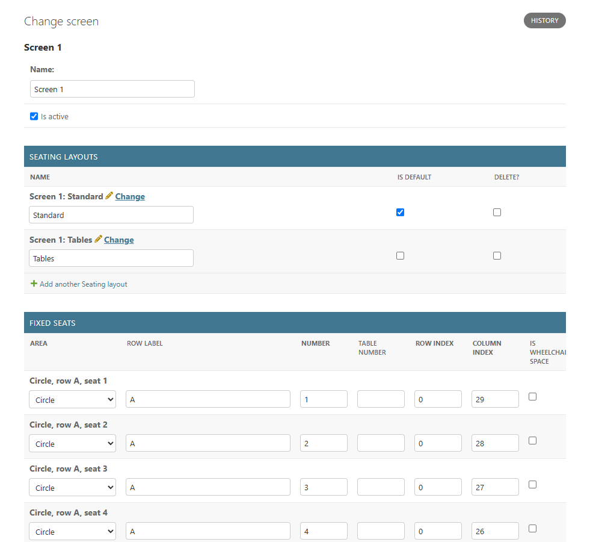

Every layout is edited on its own page in the admin, with its stalls seats listed beneath it.

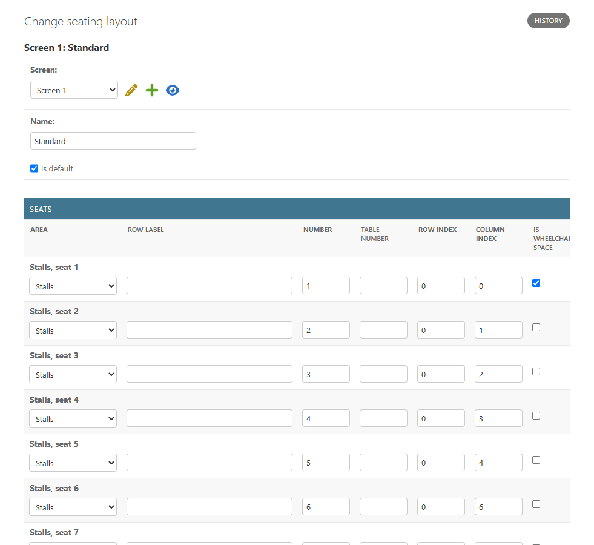

The circle is reached by stairs only, so a wheelchair space there is refused, and a layout saved without a wheelchair space in use is refused too. Here I unticked both of the Standard layout's wheelchair spaces and tried to save.

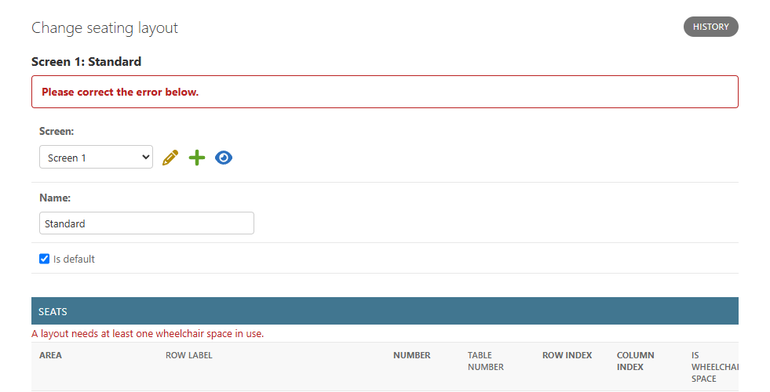

A screening picks one of its screen's layouts, and a manager can close an area for a single screening, such as the circle for a quiet showing. Capacity is never stored: it's counted from the fixed seats plus the layout's seats, leaving out closed areas and seats out of use. In the screenshot below, closing the circle takes this Nosferatu screening down to the 46 stalls seats.

The six ticket types (Adult, Student, OAP, Young person, Child and Companion) come from a data migration, each with the flags the booking rules will read. A film's rating decides which types are offered, so Child drops out of a 15 and Young person out of an 18, and only U, PG and 12A films take infants. When a screening is added, its price table fills itself from the ticket class, with Companion tickets free, and staff change any line.

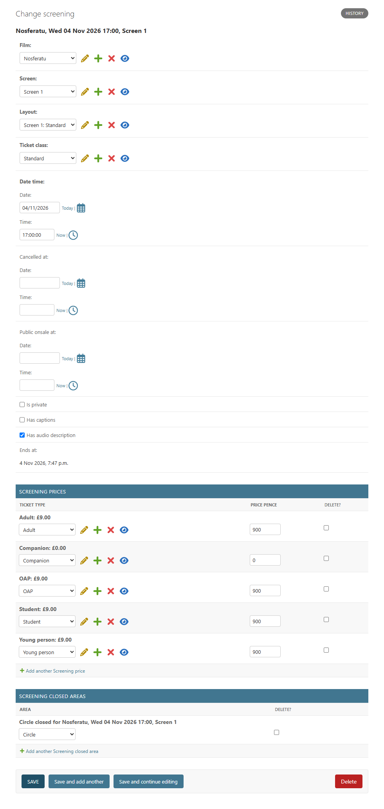

The demo seat plan comes from `python manage.py seed_seats`, explained in the entry above. Films got one more field on the way: an optional line of content advice shown with the rating, such as "Includes themes of abuse".

### 4 November 2026: browsing by day and the film page

The home page now lists one day at a time. A strip of the next seven days sits above the listings, defaulting to today, and each film's times for that day are grouped in a card with its rating. Captioned and audio described screenings carry a badge on the time itself, so nobody has to open a film to find them. Cancelled and private screenings never appear (4.11, 4.19), and a day with nothing on says so.

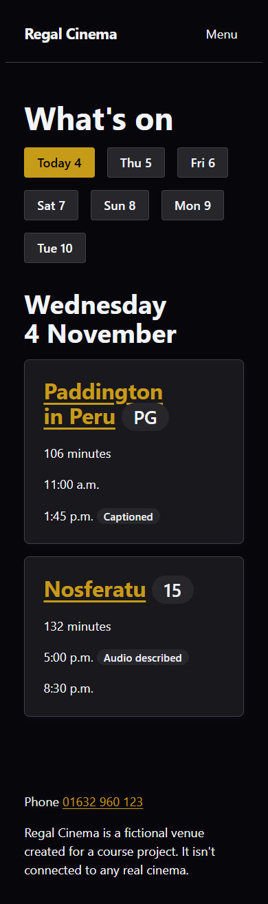 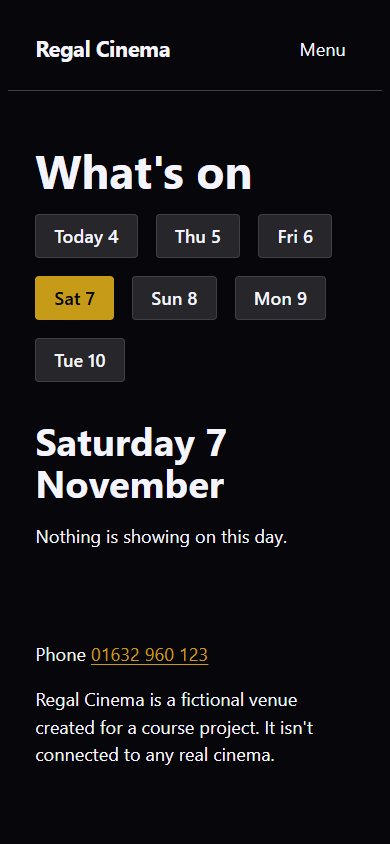

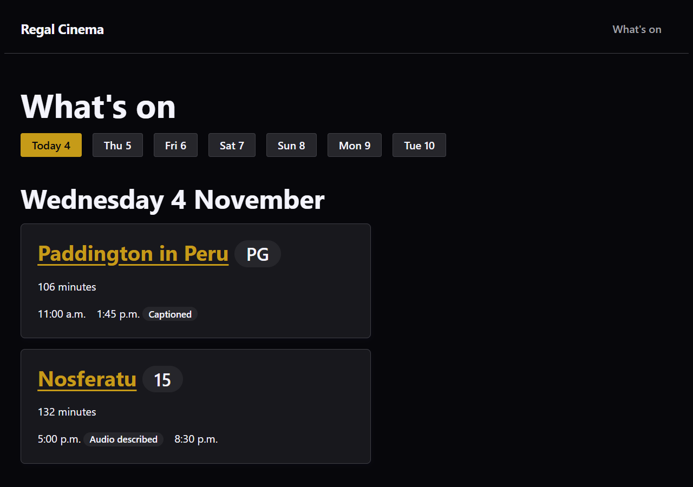

Each film has its own page at `/films/<slug>/`, opened on the same day the visitor chose on the home page. It shows the rating with any content advice, the runtime in hours and minutes, and the notes a customer needs before booking: photo ID for 12A and above, whether under 2s can come, and that the circle is stairs only. The trailer is a link to YouTube, so it never plays on its own. A film whose rating hasn't been confirmed says so, and the infant line waits until it is.

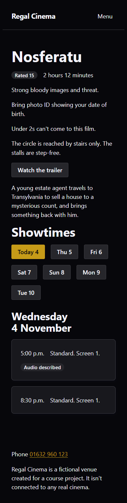 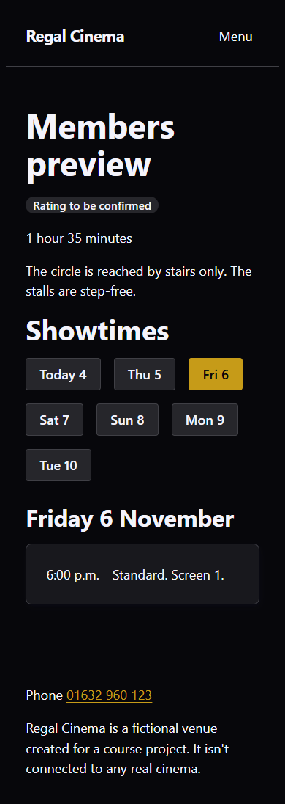

The times aren't links yet, because there's no seat map to send them to. That comes in the next block (journey 2).

### 4 November 2026: what the browser showed that the tests didn't

All 205 tests passed before I first looked at these pages in a browser, and two things were still wrong. The header and footer kept the class names from before LooseLeaf, which it doesn't style, so the site name was a plain blue link in the corner. And LooseLeaf's reset takes the bullets off a list marked `role="list"` but keeps the browser's left padding, so every strip of buttons and every card was indented. The header is now LooseLeaf's navbar, whose menu folds behind a Menu button on a phone without JavaScript, and one rule in the global layer removes the padding. Both fixes have a test, but neither problem was the kind a test would have found first. From now on I check each page in a browser before I call it done.

The first screenshot I took is on the left, and the same page after the two fixes is on the right.

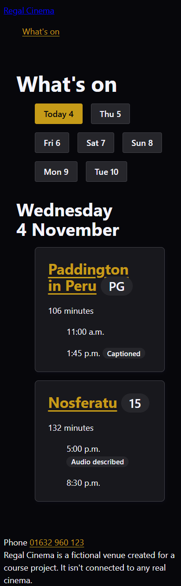 

### 9 November 2026: registering, logging in and out

Customers can now create an account, log in and log out (journey 4). Registering asks for an email address and a password typed twice, and nothing else, as 4.16 sets out.

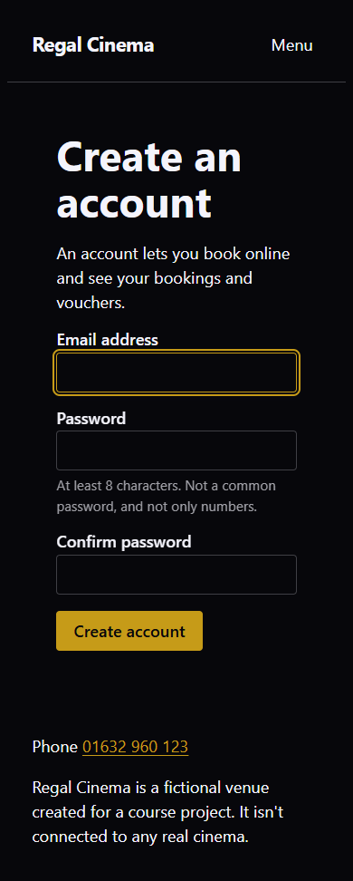

The register wireframe also had a full name and a terms checkbox, but the design brief says email and password only, and the brief wins over the wireframes. The address is stored in lower case before it's checked, so the same address with different capitals is refused as a duplicate, and the new customer is logged straight in.

Forms render through LooseLeaf's form renderer, so every error is written next to its field and the field is marked invalid for screen readers. The first version used Django's own password help, a list of four rules that pushed the confirm field off the screen on a phone. I replaced it with one plain line, and renamed "Password confirmation" to "Confirm password".

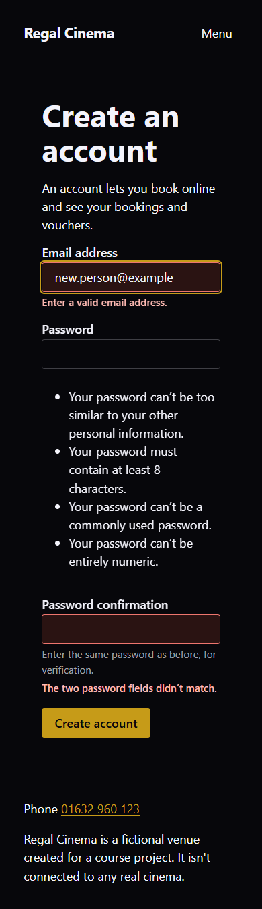 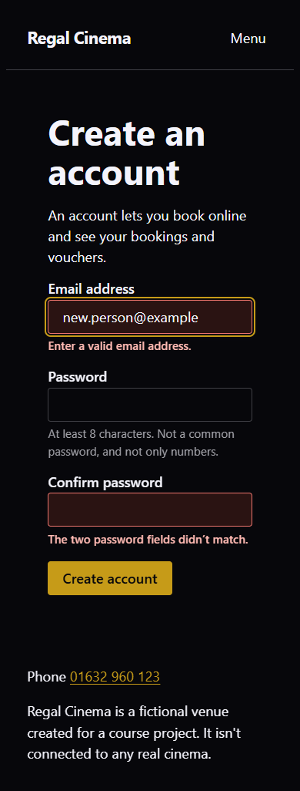

Logging in uses Django's login view with the email address. Its wrong-password message ended "Note that both fields may be case-sensitive", which isn't true here, since email addresses are matched in any case, so I wrote my own.

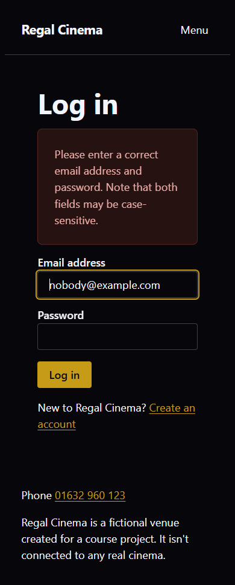 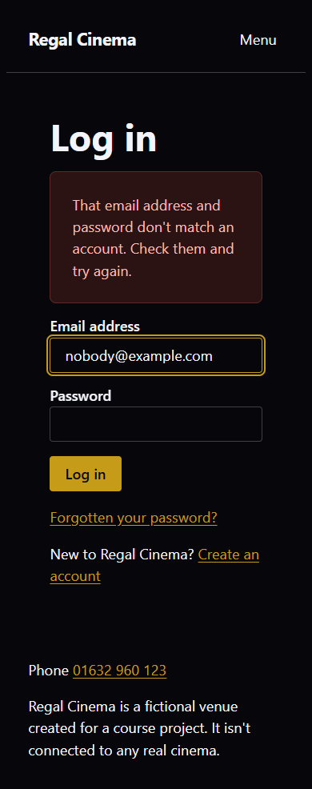

The log in and register pages send anyone already logged in back to What's on, which is a pass requirement. The menu offers Log in and Register to a visitor and Log out to a customer. Logging out changes state, so it's a small form with a button, and visiting its address directly does nothing.

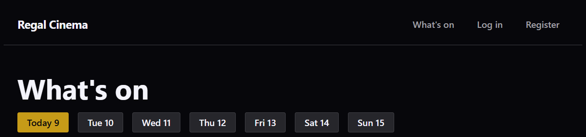

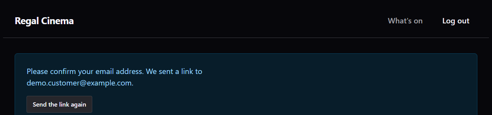

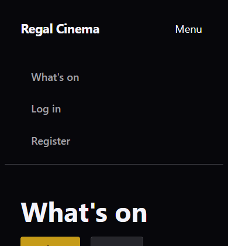

Two rows of journey 4 wait for the seat map: asking for an account at checkout, and keeping seat holds when a customer logs in mid-checkout.

### 9 November 2026: sending email

Registration (journey 4) needs to send a verification email, and password reset needs to send a link, so the site needed a way to send mail. I set up a Gmail account just for this project rather than use my own. Every email the site sends shows its address, so a personal one would be visible to anyone who registers. Registration also sends mail to whatever address is typed in, so anyone could make the site email strangers from my account. And if the password ever leaked, someone could send mail as me.

Gmail won't let an app log in with the account's normal password. It needs two-step verification switched on and an app password, a separate 16-character password that can only send mail and can be revoked on its own. The address and the app password are two environment variables, `EMAIL_HOST_USER` and `EMAIL_HOST_PASSWORD`. They're set in my local `.env` and in the Render dashboard, never in the repository, and `render.yaml` lists them as values entered in the dashboard, like `DATABASE_URL`. Every email comes from "Regal Cinema" at that address.

Without the password, the site prints each email to the terminal instead of sending it. That's what happens in the tests and on any machine without the variables, so nothing is sent by accident while I'm building.

My first version used Django's `EMAIL_BACKEND` and `EMAIL_HOST` settings, and Django refused to start. Django 6.1 has moved email configuration into a single `MAILERS` setting and won't accept the older settings alongside it. The settings now build `MAILERS` from the two variables, with a test for each case.

This also clears the error `check --deploy` has reported since the first deploy (25 October), which was Django refusing the console email backend in production. That happens once this is deployed with the variables set on Render.

### 9 November 2026: password reset and verification

With email working, the log in page links to a password reset. It emails a link that works once and lasts three days, using Django's own views and signed tokens, so nothing new is stored. The page after asking reads the same whether or not the address has an account, so the form can't be used to find out who's registered.

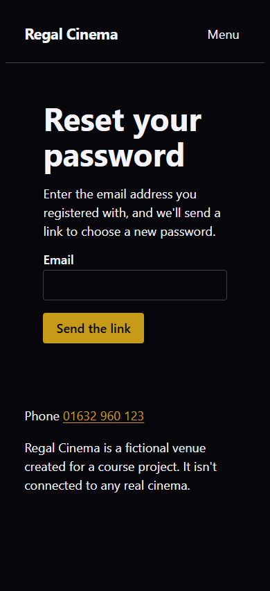 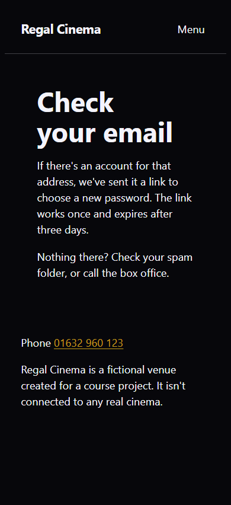 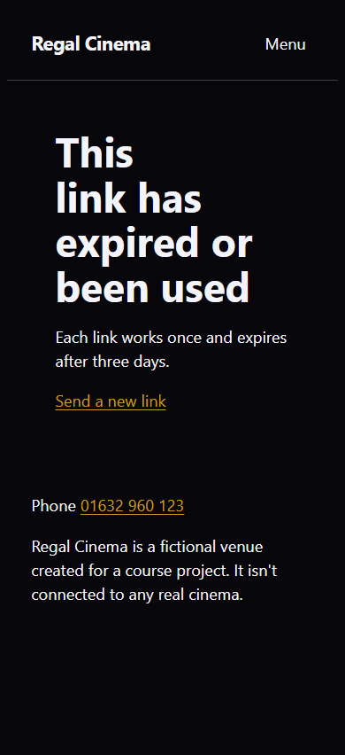

Registering now sends a verification email too, but the account works straight away. Someone booking a seat for tonight shouldn't wait for an email. The link is signed with the customer and their address and lasts three days, so a link sent to an old address can't confirm a new one. Following it records the date in `User.email_verified_at`, a field I added for this. I put it on `User` rather than waiting for `Profile`, because it describes the address that's already there, and a date says when as well as whether. If the email can't be sent, the failure is logged and registration still goes through.

Until the address is confirmed, a logged-in customer sees a reminder at the top of every page, with a button to send the link again. Django's messages now show on every page as well, which is how "We've sent a new link" appears.

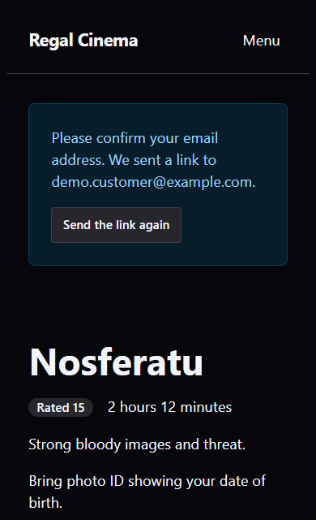 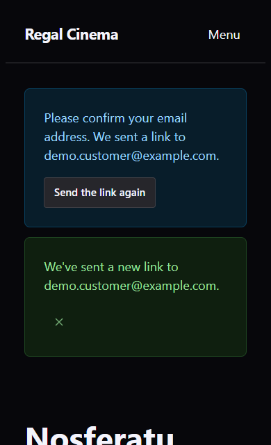

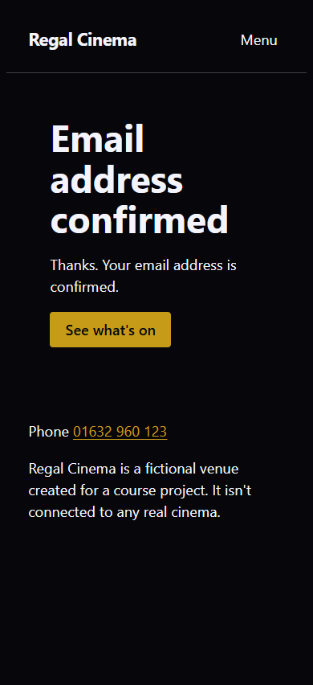 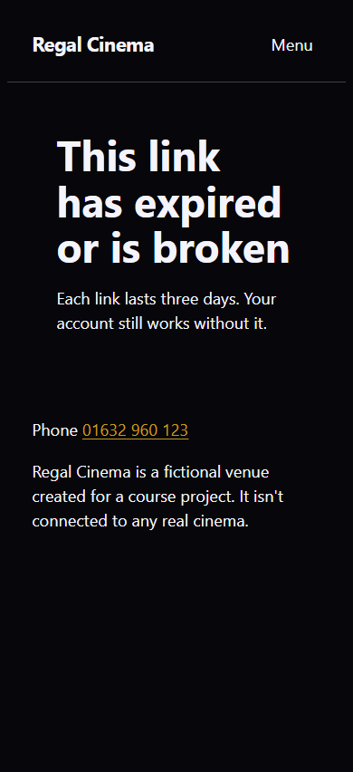

The first time I checked the reminder in a browser, it sat against the header and against the message below it, with its button pressed up under the text. Putting the reminder and the messages in one spaced region fixed it. I took the screenshots as a demo customer in my local database, with sending switched off.

### 9 November 2026: deploying the accounts, and a 500

The account pages, password reset, verification and email went live in one deploy, and every page I checked loaded. Django's deployment check (`check --deploy`) no longer reports the error from the first deploy now that email has a real backend. Two warnings remain, both asking for HSTS on every subdomain and for the site to go on browsers' preload list. I've left them off on purpose: the site lives on `onrender.com`, which Render shares between all its customers, so its subdomains aren't mine to make promises about. That would change with a domain of my own.

Earlier the same day the live site showed a 500 once, and the next load worked. I couldn't reproduce it locally, even with `DEBUG` off and the static files collected the way Render does it, and every page and admin page loaded. The likeliest cause is the database connection. Django kept each connection open for ten minutes and reused it without checking it, but Neon's free plan suspends the database after a few idle minutes and drops its connections. The cron ping keeps the web service awake without touching the database, so the database still goes to sleep, and the first request after a quiet spell could reuse a dead connection. Django now checks a kept connection before using it (`conn_health_checks`) and opens a new one if it has gone, with a test. If it happens again, Render's logs should show the traceback.

## Phase 2: Core booking skeleton, seats and holds

Phase 2

Planned scope: the transactional core of `bookings`: `SeatHold`, `Booking`, `SeatBooking`, the interactive seat map, ticket types and infants, going back to amend, immediate release of seats, and the database-level double-booking protection (4.8). Payment is stubbed at this stage, with bookings marked paid manually, so the seat concurrency logic, the highest-risk part of the project, can be built and tested before Stripe is added.

### To be completed during development

## Phase 3: Payment integration

Phase 3

Planned scope: Stripe on top of the working booking skeleton: Checkout Session creation from the pending booking and the hand-off to Stripe's hosted page, extending the holds when the customer chooses Pay, the return pages (confirming and not completed), webhook signature verification, idempotency through `StripeEvent`, and the automatic refund when a payment lands after the seats have gone (4.13). Building this after Phase 2 means payment problems and seat concurrency problems get debugged one at a time.

### To be completed during development

## Phase 4: Food and drink, membership and discounts

Phase 4

Planned scope: food and drink first, as the headline feature (4.3): the `concessions` app (`Product`, `OrderItem`) in checkout, ordering ahead with seat delivery or bar collection, the order cutoff, the sold-out switch and the staff service list; then the `membership` app (`MembershipTier`, `MembershipPurchase`, `Voucher`), including buying a gift voucher (4.26); and the discount and voucher order (4.10). This comes after payment works because there's no sensible way to test whether a discount applies correctly until a charge can already succeed without one.

### To be completed during development

## Phase 5: Priority booking and venue features

Phase 5

Planned scope: priority booking logic and the greyed-out listing state (4.18); the `venue` app (`EnquiryRequest`, `VenueSettings`, private hire and screening visibility per 4.19, 4.23); and the static pages (About, Accessibility policy, Membership terms).

### To be completed during development

## Phase 6: In-venue and staff tooling

Phase 6

Planned scope: staff-assisted card-in-person bookings (4.14) and check-in at the door (4.2); the `staff` app (audit log, refunds, customer cancellation requests, sales dashboard per 4.9 and 4.22); the permission groups and the separate `/staff/` login (4.9, 4.12). This is last among the functional work because it depends on bookings, payments and discounts already existing.

### To be completed during development

## Phase 7: Accessibility, cross-browser and testing pass

Phase 7

Planned scope: the accessibility implementation (4.17) checked properly instead of assumed; cross-browser and responsiveness checks; and the structured testing pass in [section 7](testing.md), covering validators, Lighthouse and the manual and automated test matrix.

### To be completed during development

---

[← 5. Core features](features.md) · [README](../README.md) · [7. Testing and quality assurance →](testing.md)
